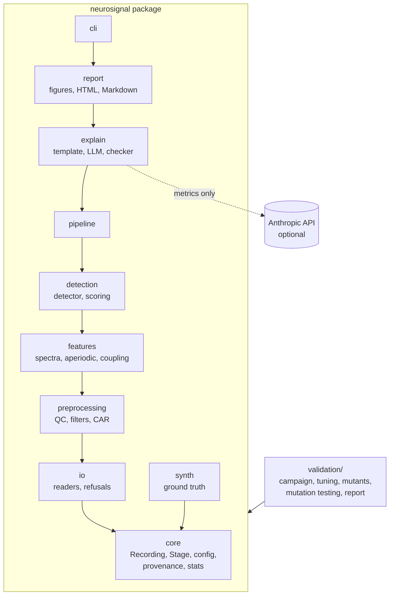
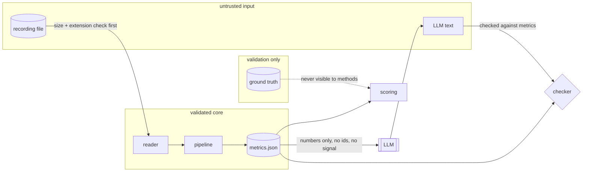
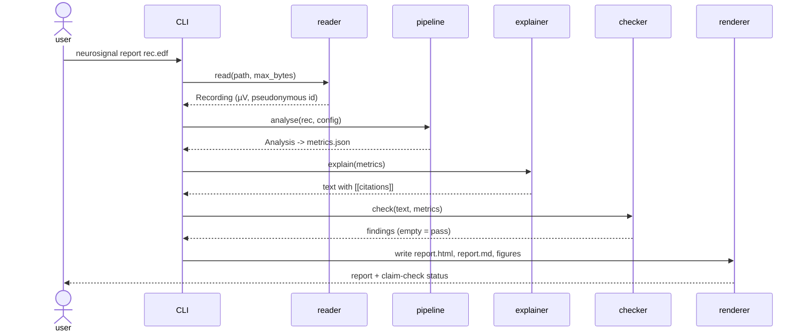
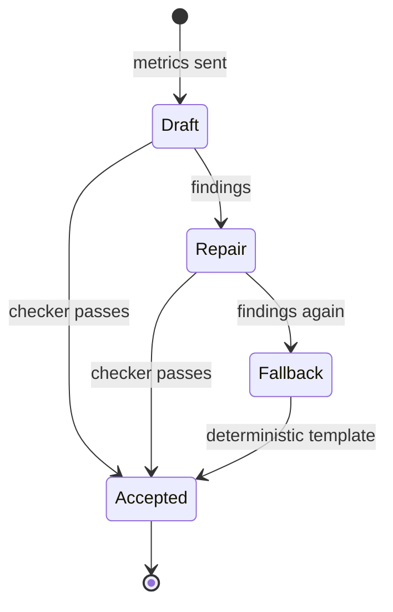
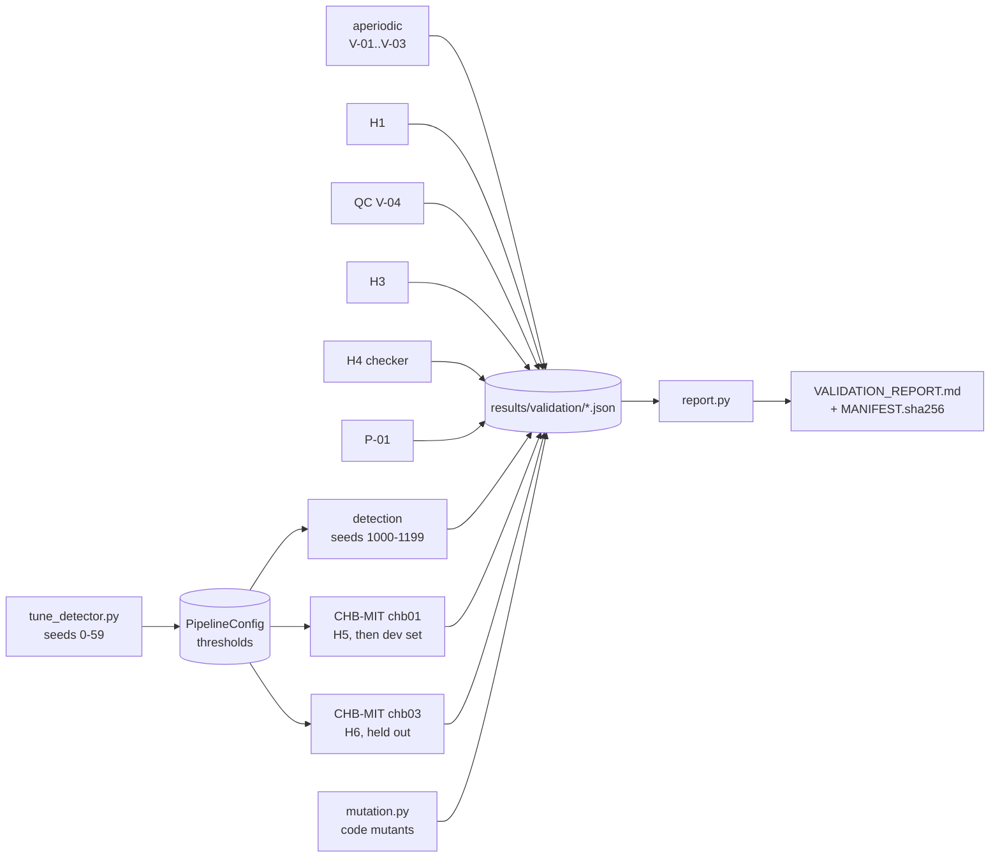

# Diagrams

Mermaid diagrams render on GitHub.

## 1. Signal chain and closed loop (system framing)

```mermaid
flowchart LR
    brain((brain)) --> elec[electrodes] --> amp[amplifier + ADC] --> file[(EDF / BDF / BrainVision)]
    file --> reader[reader<br/>size + extension check<br/>µV, no identity fields]
    reader --> qc1[flat-channel QC<br/>raw data]
    qc1 --> filt[notch 50 Hz + 0.5-45 Hz<br/>zero-phase FIR]
    filt --> qc2[amplitude QC<br/>MAD ratios]
    qc2 --> car[common average<br/>referential only]
    car --> det[event detector<br/>1-20 Hz line length<br/>+ rhythm gate]
    car --> spec[Welch spectra<br/>outside events]
    det -. exclude windows .-> spec
    spec --> ap[aperiodic + peaks]
    car --> conn[dwPLI / PLV<br/>outside events]
    det -. exclude windows .-> conn
    ap & conn & det --> metrics[(metrics.json)]
    metrics --> expl[explainer<br/>template or LLM]
    expl --> chk{claim checker}
    metrics --> chk
    chk --> report[report.html / report.md]
    report --> reader2((researcher))
    reader2 -. decides what to look at .-> file
```

The "sensor" whose errors propagate is the metrics layer; the claim checker
is the second sensor, validated by mutation testing.

## 2. Components (C4 level 2)

## 3. Data and security boundaries

## 4. Report sequence

## 5. LLM explanation states

## 6. Validation campaign

